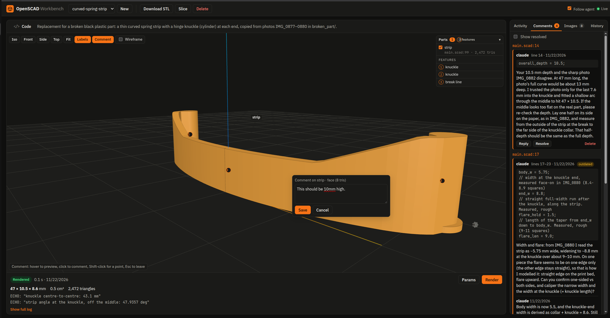
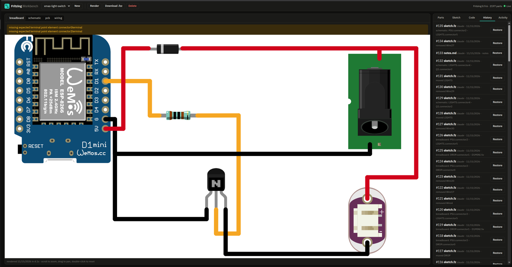
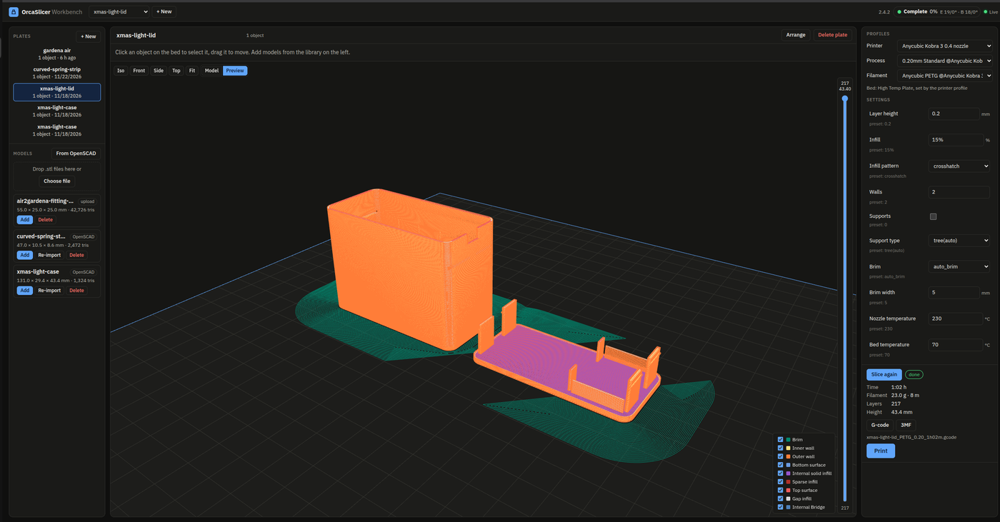

# tinkerbench

> **A completely vibe-coded project.** Everything here, code, tests and docs, was written by an AI agent. It is a tool by a hobbyist, for hobbyists: the point is to spend less time fiddling with CAD, wiring diagrams and slicer settings and more time making things. It gets you from idea, or from a broken part on the desk, to a printed or wired prototype faster. It is not polished, reviewed or production software, so expect rough edges and check measurements before you print.

Workbenches for hobby electronics and 3D printing that an AI agent drives over MCP while you watch in the browser. Each one is a small Go server with the real tool (OpenSCAD, Fritzing, OrcaSlicer) in its Docker image and a Svelte UI embedded in the binary.

| App | What it does | Port |
|---|---|---|
| [openscad_viewer/](openscad_viewer/) | The agent writes and renders OpenSCAD models; you see code and a 3D view update live and comment on lines or faces. Includes `measure_part`, which turns a scan or photo of a real part into millimetres. | 8020 |
| [fritzing/](fritzing/) | The agent builds Fritzing sketches (breadboard, schematic, PCB); the three views redraw live. | 8030 |
| [orcaslicer/](orcaslicer/) | Put STL models (uploaded or from the OpenSCAD workbench) on a plate, slice with the OrcaSlicer CLI, and print through Moonraker. | 8050 |

Every app serves its web UI, a REST API and an MCP endpoint at `/mcp` on one port, **without authentication**. Run them on a trusted network only.

## Screenshots

**OpenSCAD workbench**: a replacement spring strip copied from photos of the broken part. The person comments on a face of the model, and the agent's questions about unmeasured dimensions are pinned to the lines of code they concern.



**Fritzing workbench**: the breadboard view of a Wemos D1 mini switching a light through a transistor, with every change the agent made in the history on the right.



**OrcaSlicer workbench**: a case and lid for that light, imported from the OpenSCAD workbench and sliced with the Kobra 3 presets, shown in the layer preview and ready to print.



## Quick start

```console
$ task demo:up
$ claude
> I want to use a supermicro esp board with a DHT11 to create a temperature hudmitdy sensor. Design the circuit for me in fritzing including using aaa batteries. After the circuit is finished and the amount of batteries is determined design a case for it.
```

Approve the `demo-*` MCP servers when Claude Code asks, and watch http://localhost:8030 (Fritzing) and http://localhost:8020 (OpenSCAD) while it works. The [example](#example) shows what came out of this prompt. `task demo:down` stops the demo again.

## Example

**[ESP32-C3 temperature and humidity sensor on AAA batteries](examples/esp32-temperature-sensor/)**: the prompt above took this from a circuit in Fritzing (an ESP32-C3 SuperMini, a DHT11 and 3 × AAA batteries) to a printed case in OpenSCAD, and a follow-up sliced the case in OrcaSlicer. The folder has the prompt, the `.fzz` and `.scad` files, the wiring notes and screenshots of all three workbenches. It was done in one go and hasn't been built, so expect issues.

## Running the apps

```sh
cp .env.example .env    # optional: PRINTER_URL, BED_SIZE
docker compose up -d --build
```

Then open http://localhost:8020, http://localhost:8030 and http://localhost:8050, and connect your agent, e.g. for Claude Code:

```sh
claude mcp add --transport http openscad   http://localhost:8020/mcp
claude mcp add --transport http fritzing   http://localhost:8030/mcp
claude mcp add --transport http orcaslicer http://localhost:8050/mcp
```

[skills/](skills/) has agent skills for using the workbenches well (`task skills:install`).

Data lives in `./data/<app>`. The images are amd64 only.

## Together or on their own

The three workbenches are built to work as one bench for a whole project: wire up the electronics in Fritzing, model the enclosure, mounts or replacement parts around them in OpenSCAD, then slice and print in OrcaSlicer. The agent connects to all three at once, so it can carry the board size, connector positions and mounting holes from the circuit over to the model, and the slicer can import models straight from the OpenSCAD workbench (see below).

Each one also works by itself. Run only the app you need: the OpenSCAD workbench without a slicer, Fritzing for a circuit that never gets a case, or the slicer with STLs from anywhere. None of them needs the others to start, and the links between them are optional settings.

## Connecting the apps

- `SLICER_URL` on the OpenSCAD workbench (the slicer as the browser reaches it) shows a "Slice" button that opens the current model in the slicer.
- `OPENSCAD_URL` (server to server) and `OPENSCAD_PUBLIC_URL` (for links) on the slicer let it import STLs from the workbench.
- `PRINTER_URL` on the slicer points to a Moonraker API. Without it, slicing works and printing is disabled. The default presets are for an Anycubic Kobra 3; change them with `DEFAULT_MACHINE`, `DEFAULT_PROCESS` and `DEFAULT_FILAMENT`.

Each app's README lists all its settings.

## Development

Needs Go, Node and [Task](https://taskfile.dev). `task --list` shows everything; the main ones:

- `task test`: Go tests of all three apps (see each README for the test data some tests need).
- `task openscad:run`, `task orcaslicer:run`: run locally against `./data`.
- `task fritzing:docker:run`: Fritzing only runs in its image.
- `task <app>:web:dev`: Vite dev server with hot reload.
- `task hooks:install`: once per clone, enables a pre-commit hook that runs [gitleaks](https://github.com/gitleaks/gitleaks) on the staged changes (`go install github.com/zricethezav/gitleaks/v8@latest`). `task secrets:scan` checks the whole history.
