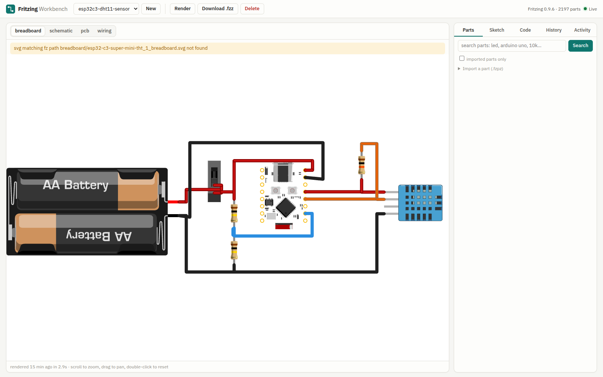
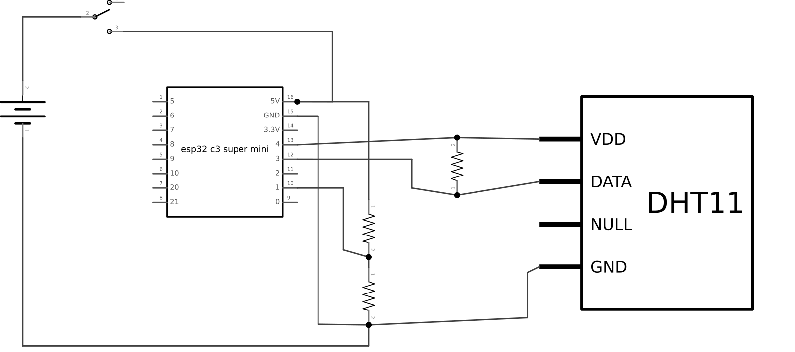
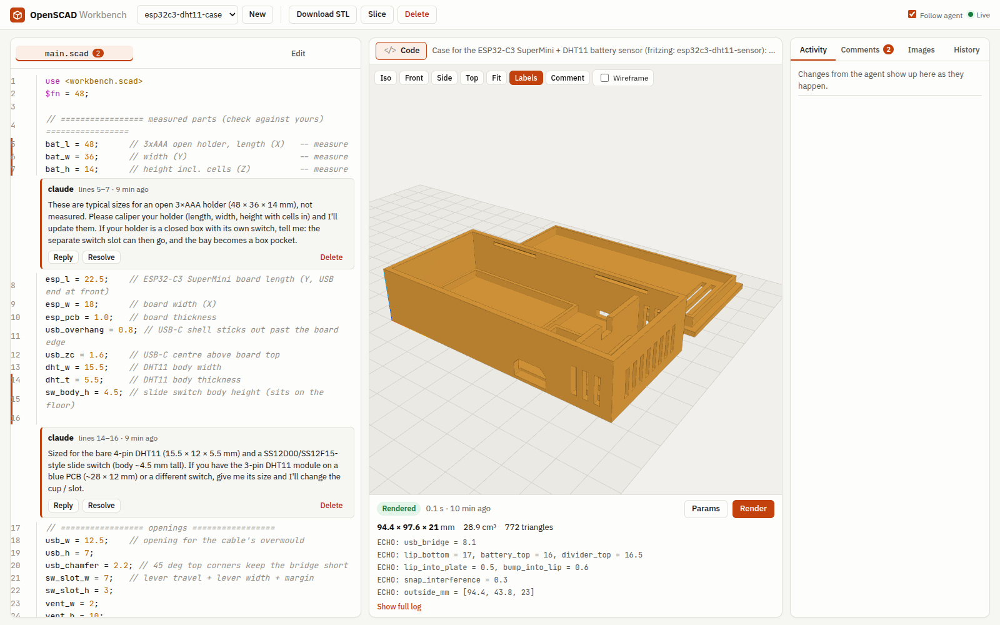
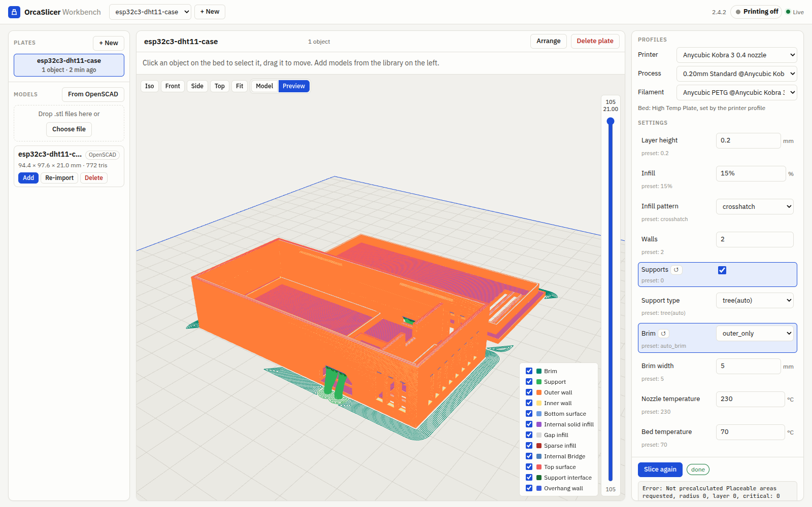

# ESP32-C3 temperature and humidity sensor on AAA batteries

> **Disclaimer:** this example was done in one go from a single prompt. Nothing here has been built, measured, flashed or printed, and it probably has issues. Check the circuit against your real parts and measure them before printing the case. Treat it as a worked example of the workbenches, not a verified design.

A battery-powered temperature/humidity sensor: an ESP32-C3 SuperMini reads a DHT11, sends the reading over Wi-Fi and goes back to deep sleep. The circuit was designed in the Fritzing workbench, then the number of batteries it settled on was used to design a printed case in the OpenSCAD workbench. Both were built by Claude Code over the workbenches' MCP servers from one prompt.

## The prompt

> I want to use a supermicro esp board with a DHT11 to create a temperature hudmitdy sensor. Design the circuit for me in fritzing including using aaa batteries. After the circuit is finished and the amount of batteries is determined design a case for it.

"supermicro esp board" was read as the **ESP32-C3 SuperMini**.

## Files

| File | What it is |
|---|---|
| [esp32c3-dht11-sensor.fzz](esp32c3-dht11-sensor.fzz) | Fritzing sketch (breadboard + schematic), with the imported SuperMini and DHT11 parts bundled |
| [wiring.md](wiring.md) | Wiring description from the workbench (`get_wiring`): notes, connections with wire colours, pins in use, parts list |
| [case.scad](case.scad) | OpenSCAD source of the case (base + lid), all dimensions as variables at the top |
| [case.stl](case.stl) | Base and lid side by side, in print orientation |
| `*.png` | Screenshots of the breadboard, schematic, case and sliced plate (below) |

`case.scad` starts with `use <workbench.scad>` for `part()` / `feature()`. Outside the workbench, copy [workbench.scad](../../openscad_viewer/internal/render/library/workbench.scad) next to it.

## Circuit (Fritzing workbench)

### How many batteries: 3 × AAA

The pack feeds the SuperMini's **5V** pin through a slide switch, and the board's own 3.3 V regulator (ME6211, about 0.1–0.25 V dropout) does the rest.

| Cells | Voltage | Verdict |
|---|---|---|
| 2 × AAA | 3.0 V, sagging to ~2.4 V | Too low: the ESP32-C3 needs 3.0 V, and there is no headroom for the regulator |
| **3 × AAA** | **4.5 V (4.8 V fresh)** | **Runs the regulator down to ~1.15 V per cell (≈3.45 V), using most of an alkaline cell** |
| 4 × AAA | 6.0–6.4 V | Close to the regulator's 6.5 V limit; the extra volt only becomes heat |

The Fritzing drawing uses the stock 2 × AA holder art, because the library has no 3 × AAA part. The build uses a 3 × AAA holder.

### Pins

| Function | Pin | Notes |
|---|---|---|
| DHT11 power | GPIO4 | The sensor is powered from a pin so it draws nothing in deep sleep. Set it HIGH about 1.5 s before reading and LOW before sleeping. |
| DHT11 data | GPIO3 | 10 kΩ pull-up (R1) to the sensor's power line, so it is unpowered in sleep too |
| Battery level | GPIO1 (ADC1) | 100k/100k divider (R2/R3) from the switched battery line; battery voltage = 2 × reading |

GPIO2, GPIO8 (onboard LED) and GPIO9 (BOOT button) affect how the chip starts up, so they are left free.

### Parts

- ESP32-C3 SuperMini
- DHT11, the bare 4-pin sensor. The 3-pin module on a blue board already has the pull-up, so leave R1 out.
- 3 × AAA holder
- small slide switch (SS12D00 / SS12F15 style)
- resistors: 1 × 10 kΩ, 2 × 100 kΩ

### Before powering up

- **Remove the SuperMini's red power LED.** It draws 1–3 mA all the time and would empty the batteries in weeks.
- **Switch the batteries off while USB is plugged in.** USB 5 V and the 5V pin are connected, so USB could feed back into the cells.
- With the switch on, check 4.2–4.8 V on the 5V pin and 3.3 V on 3V3.

Rough battery life (estimate, not measured): about 5–6 months when reporting every 15 minutes with a ~1.5 s Wi-Fi connection (static IP). With a 10-minute interval and slow DHCP connects, about 2 months.

### Checks

- `check_circuit` reports no errors or warnings, and the connections match in the breadboard and schematic views.
- The schematic still has four layout warnings, which come from the DHT11 symbol's oversized empty box: the wires end at its pins.
- Neither part was in Fritzing's library:
  - the DHT11 comes from [Adafruit's Fritzing library](https://github.com/adafruit/Fritzing-Library)
  - the SuperMini is a community part from [byTheTV/AirGlove](https://github.com/byTheTV/AirGlove), with its pins renamed (GPIO4, 5V, GND, …) so the checks can read them
- Its PCB footprint is unverified. The PCB view isn't routed, because the build is hand-wired.

## Case (OpenSCAD workbench)

The case is 94 × 44 × 23 mm and prints without supports. The base prints upright; the lid prints top face down, next to it.

- **Battery bay:** locating ribs for an open 3 × AAA holder
- **Board cradle:** the USB-C port faces a cut-out in the front wall, so the board can be flashed in the case
- **Switch slot:** in the back wall, for the slide switch lever
- **Sensor chamber:** behind a divider with a wire notch, so the DHT11 is screened from the battery bay and the board. It has vents in its walls and floor, and a cup that holds the sensor upright.
- **Lid:** an inner lip with 45° snap bumps that click into grooves in the walls, plus vents over the sensor

Every feature that starts above the print bed has an `assert` in the model, and all of them pass:

- the USB opening has 45° top corners, which leaves an 8.1 mm flat top
- the switch slot and vents are short bridges
- the snap grooves and bumps have 45° diamond profiles
- the lid's lip and bumps overlap what they grow from by at least 0.4 mm

### Measure before printing

The holder, sensor and switch sizes are typical values, not measurements:

| Variable | Default | What to measure |
|---|---|---|
| `bat_l`, `bat_w`, `bat_h` | 48 × 36 × 14 mm | The 3 × AAA holder, with the cells in |
| `dht_w`, `dht_t` | 15.5 × 5.5 mm | The DHT11 body |
| `sw_body_h`, `sw_slot_w` | 4.5 mm, 7 mm | The slide switch |

If your holder is a closed box with its own switch, drop the switch slot.

## Slice (OrcaSlicer workbench)

The case was imported from the OpenSCAD workbench, with base and lid on one plate in print orientation. It was sliced for an Anycubic Kobra 3 (0.4 mm nozzle) with these presets:
- process: 0.20mm Standard
- filament: Anycubic PETG

| Override | Value |
|---|---|
| `brim_type` | `outer_only` (5 mm brim) |
| `enable_support` | `1` (tree supports) |

| Result | |
|---|---|
| Estimated time | 1 h 12 min |
| Filament | 32.4 g (10.6 m) |
| Layers | 105 (21 mm) |
| Bed | High Temp Plate, 70 °C |

The model was designed to print without supports, so supports only appear in a few spots, such as the USB opening. They are on because they were asked for. The G-code isn't included; slice it again in the workbench to get it.

## Not done

- No firmware yet. The pins and timings above are what it needs.
- Not printed yet.
